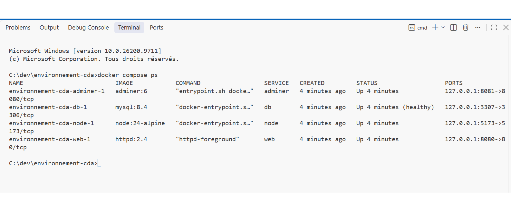
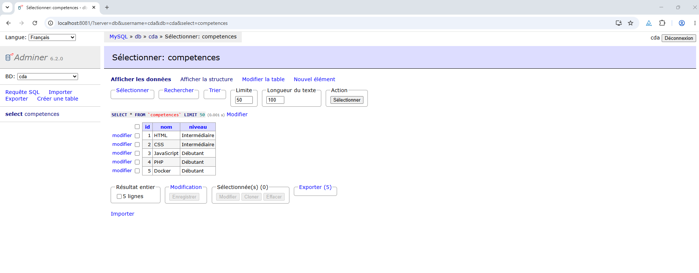

# Environnement CDA — Docker

Projet réalisé dans le cadre de ma formation Concepteur Développeur d'Applications (CDA) à l'AFPA.

## 1. Installation

Environnement utilisé :

- Windows 11
- WSL 2 avec Ubuntu
- Docker Desktop
- Docker Engine 29.9.2
- Docker Compose v5.6.1
- Apache HTTP Server 2.4

Commandes de vérification :

```bash
docker --version
docker compose version
docker run hello-world
```

Résultats : Docker fonctionne correctement et le test `hello-world` est réussi.

## 2. Servir ma-page-dev avec Apache

Le portfolio `ma-page-dev` est développé avec Vite.

### Construire le site

Dans `C:\dev\ma-page-dev` :

```bash
npm run build
```

Cette commande génère le dossier `dist`.

### Lancer Apache avec Docker

Depuis un terminal Windows :

```powershell
docker run -d --name ma-page-apache -p 127.0.0.1:8080:80 --mount "type=bind,source=C:\dev\ma-page-dev\dist,target=/usr/local/apache2/htdocs,readonly" httpd:2.4
```

### Consulter le site

- Accueil : http://localhost:8080
- Projets : http://localhost:8080/projets.html

### Vérifier le conteneur

```bash
docker ps
docker exec ma-page-apache ls /usr/local/apache2/htdocs
docker logs ma-page-apache
```

Les pages HTML sont accessibles et les journaux Apache confirment des réponses HTTP 200.

### Mettre à jour le site

1. Modifier les fichiers du projet `ma-page-dev`.
2. Exécuter `npm run build`.
3. Actualiser le navigateur.

Le dossier `dist` étant monté dans le conteneur, les modifications sont disponibles sans reconstruire l'image Docker.

## 3. Sécurité

- Port publié uniquement sur `127.0.0.1:8080`.
- Dossier du site monté en lecture seule.
- Fichier `.env` exclu du dépôt Git.

## 4. Comparaison des images Docker

J'ai comparé les images officielles `httpd:2.4` et `httpd:2.4-alpine` sur Docker Hub.

- `httpd:2.4` : 177 Mo d'espace disque.
- `httpd:2.4-alpine` : 97,4 Mo d'espace disque.

**Justification :**

J'ai choisi `httpd:2.4` car c'est une image officielle Apache adaptée à notre environnement de formation. Même si la variante Alpine est plus légère, la version standard offre un environnement plus classique pour apprendre et effectuer les exercices. Elle permet mieux de servir mon portfolio `ma-page-dev` avec Apache.

## Fiche 2 — Exercice 2 : Documentation MySQL

1 - Laquelle des variables est obligatoire ?

This variable is mandatory and specifies the password that will be set for the MySQL root superuser account.
MYSQL_ROOT_PASSWORD est la variable obligatoire pour définir le mot de passe de l'administrateur root.

2 - Que deviennent les variables si le volume contient déjà une base ?

any pre-existing database will always be left untouched on container startup.
les variables d'initialisation n'ont plus d'effet sur la base existante. Les données déjà présentes sont conservées.

3 - Pourquoi Adminer peut-il refuser la connexion juste après le premier docker run ?

it will not accept incoming connections until such initialization completes.
Lors du premier démarrage, MySQL doit initialiser sa base de données. Pendant cette opération, il n'accepte pas encore les connexions. Adminer doit donc attendre que MySQL soit prêt.

4 - Où l'image cherche-t-elle des scripts à exécuter au premier démarrage, et de quels types ?

it will execute files with extensions .sh, .sql, .sql.gz, .sql.bz2, .sql.xz, and .sql.zst that are found in /docker-entrypoint-initdb.d.
Les scripts sont recherchés dans le dossier /docker-entrypoint-initdb.d. Ils peuvent être des fichiers SQL, des scripts Shell et des fichiers SQL compressés.

## Fiche 2 — Exercice 3 : MySQL et Adminer

### Installation

- MySQL : `mysql:8.4`
- Adminer : `adminer:latest` (version utilisée : 6.2.0)
- Réseau Docker : `cda`
- Volume persistant : `cda-donnees`
- Base de données : `cda`
- Utilisateur : `cda`
- Mots de passe : définis dans `.env`, non publiés sur GitHub

### Accès

- MySQL : `127.0.0.1:3307`
- Adminer : `http://localhost:8081`
- Serveur dans Adminer : `cda-mysql`

### Commandes de démarrage

MySQL :

```cmd
docker run -d --name cda-mysql --network cda -p 127.0.0.1:3307:3306 --env-file .env -v cda-donnees:/var/lib/mysql mysql:8.4
```

Adminer :

```cmd
docker run -d --name cda-adminer --network cda -p 127.0.0.1:8081:8080 -e ADMINER_DEFAULT_SERVER=cda-mysql adminer:latest
```

### Test de persistance

J'ai créé une table `competences` contenant cinq lignes : HTML, CSS, JavaScript, PHP et Docker.

J'ai arrêté et supprimé le conteneur `cda-mysql`, puis je l'ai recréé avec le même volume `cda-donnees`.

Après redémarrage, la requête `SELECT * FROM competences;` a retrouvé les cinq lignes.

**Conclusion :** les données sont conservées dans le volume Docker, même lorsque le conteneur est supprimé.

### Documentation officielle MySQL

**Section :** Environment Variables

**Phrase anglaise :**

> Any pre-existing database will always be left untouched on container startup.

**Traduction :** Toute base de données préexistante reste inchangée au démarrage du conteneur.

### Fiche 2 — Exercice 4 : MongoDB (bonus)

Dans MySQL, la table `competences` possède une structure définie avec les mêmes colonnes (`id`, `nom`, `niveau`) pour chaque ligne.

Dans MongoDB, les documents de la collection `livres` peuvent avoir des champs différents : le deuxième livre possède un champ `genre` absent du premier.

## Fiche 3 — Exercice 2 : Docker Compose documentation

1 - What is the difference between a container that is "running" and a service that is "ready"? Why does it matter for a database?
A running container is started, but its service may not be ready to accept connections.
This matters for a database because it needs time to initialize before accepting connections.

2 - In the compose.yaml of environnement-cda, which service waits for which, and what makes the db service "healthy"?
In our planned compose.yaml, the adminer service waits for the db service.
The db service becomes healthy when its healthcheck runs mysqladmin ping successfully.

## Fiche 3 — Exercice 3 : Démarrer l'environnement avec Docker Compose

### Prérequis

- Docker Desktop démarré avec le moteur actif
- Node.js et npm pour construire le portfolio
- Fichier `.env` configuré à partir de `.env.example`
- Dossiers `environnement-cda` et `ma-page-dev` dans `C:\dev`

### Démarrage

Construire le portfolio :

```powershell
cd C:\dev\ma-page-dev
npm run build
```

Démarrer les quatre services :

```powershell
cd C:\dev\environnement-cda
docker compose up -d
docker compose ps
```

### Services et adresses

| Service | Adresse               | Utilité                         |
| ------- | --------------------- | ------------------------------- |
| Apache  | http://localhost:8080 | Portfolio construit             |
| Adminer | http://localhost:8081 | Administration MySQL            |
| MySQL   | 127.0.0.1:3307        | Base de données                 |
| Vite    | http://localhost:5173 | Développement avec rechargement |

Connexion Adminer :

- Système : MySQL / MariaDB
- Serveur : `db`
- Utilisateur : `cda`
- Base de données : `cda`
- Mot de passe : défini localement dans `.env`

### Commandes utiles

```powershell
docker compose ps
docker compose logs db
docker compose logs -f node
docker compose down
docker compose up -d
```

### Test de persistance

J'ai arrêté les quatre services avec `docker compose down`, puis je les ai redémarrés avec `docker compose up -d`.

MySQL est revenu en état `healthy`.

La table `competences` contient toujours ses cinq lignes : HTML, CSS, JavaScript, PHP et Docker.

Les données sont conservées grâce au volume nommé `cda-donnees`, réutilisé dans Compose.

### Sécurité

Les mots de passe sont conservés dans `.env`, exclu de Git grâce à `.gitignore`.

Le fichier `.env.example` contient uniquement des valeurs fictives.

**Attention :** ne jamais utiliser `docker compose down -v` sans vérifier les volumes concernés. Cette option peut supprimer définitivement des données.

### Captures de vérification





## Fiche 3 — Exercice 4 : Test du clone GitHub (bonus)

### Test du dépôt sur un clone neuf

Le dépôt `environnement-cda` a été cloné depuis GitHub dans `C:\dev\essais\test-clone`.
Le fichier `.env` était absent du clone, conformément aux règles de sécurité Git. Il a été créé à partir de `.env.example`.

La commande `docker compose config --quiet` a réussi.

### Difficultés rencontrées

- Les chemins relatifs `../ma-page-dev` ne fonctionnaient plus depuis le dossier `test-clone`.
- Le projet nécessite le dossier `ma-page-dev` à côté de `environnement-cda`.
- Le volume externe `cda-donnees` est nécessaire pour retrouver les données du projet principal.

Pour ce test, les chemins ont été adaptés et un volume MySQL indépendant a été utilisé afin de protéger les données principales.

### Vérification de santé MySQL

Le clone a démarré avec `docker compose up -d`.

La commande `docker inspect` a confirmé :

- Status : `healthy`
- FailingStreak : `0`
- ExitCode : `0` pour les cinq dernières vérifications.

### Conclusion

Le clone a fonctionné après adaptation de ses chemins et de ses variables d'environnement.
Le clone a ensuite été arrêté avec `docker compose down`, puis l'environnement principal a été redémarré avec succès.
